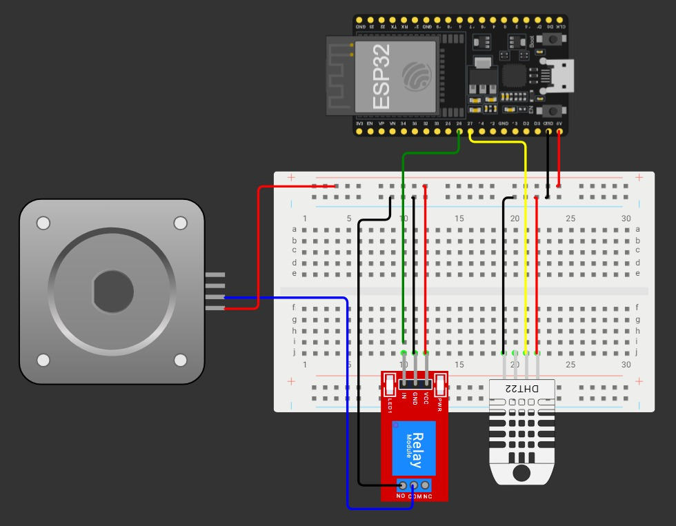
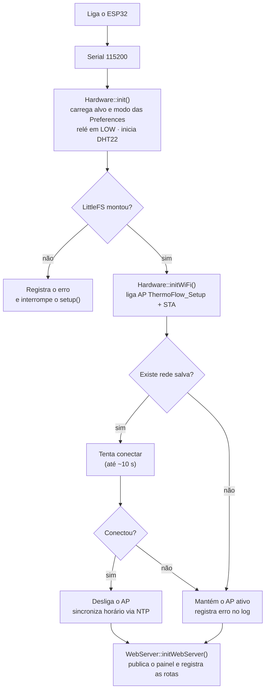

# 🌡️ ThermoFlow

**Controle de ventilador com ESP32, sensor DHT22 e painel Web.**

O ThermoFlow mede a temperatura e a umidade do ambiente e liga ou desliga um ventilador através de um relé. O controle pode ser **manual**, pelo painel no navegador, ou **automático**: o ventilador liga quando a temperatura passa do valor desejado e desliga quando ela volta a cair.

Todo o sistema roda dentro do próprio ESP32. Ele é ao mesmo tempo o controlador do hardware e o servidor Web que entrega o painel, então não existe servidor externo nem banco de dados.

> Projeto da disciplina de **Conectividade de Sistemas Ciberfísicos** — Engenharia de Software, PUCPR.

---

## Sumário

- [Funcionalidades](#funcionalidades)
- [Arquitetura do sistema](#arquitetura-do-sistema)
- [Esquema elétrico](#esquema-elétrico)
- [Bibliotecas utilizadas](#bibliotecas-utilizadas)
- [Estrutura do código](#estrutura-do-código)
- [Funcionamento do firmware](#funcionamento-do-firmware)
- [Rotas HTTP](#rotas-http)
- [Painel Web](#painel-web)
- [Como compilar e gravar](#como-compilar-e-gravar)
- [Autores](#autores)

---

## Funcionalidades

| Funcionalidade | Como funciona |
|---|---|
| **Leitura do ambiente** | Temperatura (°C) e umidade (%) lidas do DHT22 |
| **Controle manual** | Liga/desliga o ventilador pelo painel |
| **Modo automático** | Liga acima da temperatura desejada e desliga abaixo de `desejada − histerese` |
| **Preferências persistentes** | Temperatura desejada, modo automático e rede Wi-Fi ficam salvos na memória flash e sobrevivem a reinicializações |
| **Histórico** | Leituras gravadas periodicamente em `history.csv` e exibidas em gráfico |
| **Logs de erro** | Falhas do sensor, do Wi-Fi e do sistema de arquivos são registradas em `logs.txt` |
| **Configuração de Wi-Fi sem reprogramar** | Se não conseguir se conectar, o ESP32 cria a rede própria `ThermoFlow_Setup`. A página de cadastro do Wi-Fi também pode ser aberta pelo botão de configurações do painel |
| **Data e hora reais** | Horário sincronizado via NTP (fuso UTC−3) |

---

## Arquitetura do sistema

O sistema tem três camadas, todas dentro do ESP32: **hardware** (sensor e relé), **firmware** (lógica de controle e servidor HTTP) e **interface Web** (arquivos estáticos guardados na flash e executados no navegador do usuário).

O caminho de uma ação do usuário é sempre o mesmo:

1. O **navegador** (celular ou PC), conectado à mesma rede Wi-Fi do ESP32, faz uma requisição HTTP.
2. O **servidor assíncrono** (`ESPAsyncWebServer`, porta 80) recebe a requisição. Se for um arquivo do painel, ele entrega direto do LittleFS. Se for uma rota `/api/...`, o `Routes.h` encaminha para o controller certo.
3. O **controller** valida os parâmetros e chama o `Hardware.h`, que é o único ponto do código que mexe no sensor, no relé e no Wi-Fi. Quando a configuração muda, ele também salva nas Preferences.
4. Em paralelo, o **`loop()`** lê o sensor periodicamente, grava o histórico e, no modo automático, decide sozinho se liga ou desliga a fan.

### Armazenamento

O ESP32 usa duas áreas diferentes da memória flash:

- **Preferences (NVS):** pares chave-valor pequenos e de escrita rara.
  - namespace `configs`: `target` (temperatura desejada, padrão 21 °C) e `automode` (padrão desligado)
  - namespace `wifi`: `ssid` e `pass`
- **LittleFS:** sistema de arquivos para conteúdo maior.
  - `thermoflow.html`, `thermoflow.css`, `thermoflow.js`: o painel
  - `history.csv`: uma linha por leitura, `AAAA-MM-DD HH:MM:SS,temperatura,umidade`
  - `logs.txt`: uma linha por erro, `[data hora] ERRO: mensagem`

---

## Esquema elétrico



---

## Bibliotecas utilizadas

### Firmware (ESP32)

| Biblioteca | Origem | Uso no projeto |
|---|---|---|
| `WiFi.h` | Core ESP32 | Conexão em modo estação (STA) e ponto de acesso (AP) |
| `ESPAsyncWebServer.h` | [ESP32Async/ESPAsyncWebServer](https://github.com/ESP32Async/ESPAsyncWebServer) (precisa da **AsyncTCP**) | Servidor HTTP assíncrono: atende requisições sem travar o `loop()` |
| `DHT.h` | [Adafruit DHT sensor library](https://github.com/adafruit/DHT-sensor-library) (precisa da **Adafruit Unified Sensor**) | Leitura do DHT22 |
| `LittleFS.h` | Core ESP32 | Sistema de arquivos na flash: painel, histórico e logs |
| `Preferences.h` | Core ESP32 | Armazenamento chave-valor (NVS) das configurações |
| `time.h` | Core ESP32 | `configTime` / `getLocalTime` para o horário via NTP |

As respostas das rotas são montadas manualmente como `String`. O projeto **não usa** biblioteca de serialização (como ArduinoJson).

### Interface Web

| Biblioteca | Origem | Uso |
|---|---|---|
| [uPlot](https://github.com/leeoniya/uPlot) 1.6.32 | CDN jsDelivr | Gráfico do histórico |
| Inter e Fraunces | Google Fonts | Tipografia |

O restante é HTML, CSS e JavaScript puros, sem framework. Como o uPlot e as fontes vêm da internet, o gráfico só aparece se o **dispositivo do usuário** tiver acesso à internet. O resto do painel funciona normalmente.

---

## Estrutura do código

```
ProjetoEmbarcado/
├── ProjetoEmbarcado.ino        # setup() e loop()
├── Hardware.h                  # sensor, relé, Wi-Fi, NTP, logs e estado global
├── WebServer.h                 # arquivos estáticos, rotas e página /config
├── Routes.h                    # tabela de rotas
├── Config_example              # modelo do Config.h
├── src/
│   └── controllers/
│       ├── AutoModeController.h    # GET/POST /api/mode
│       ├── ConnectionController.h  # GET/POST /api/conn
│       ├── DhtController.h         # GET /api/dht
│       ├── FanController.h         # GET/POST /api/fan
│       ├── LogController.h         # GET /api/logs
│       └── TargetTempController.h  # GET/POST /api/temp
└── data/                       # gravado no LittleFS
    ├── history.csv
    ├── thermoflow.css
    ├── thermoflow.html
    └── thermoflow.js
```

---

## Funcionamento do firmware

### Inicialização (`setup`)



Com o AP e o modo estação ligados ao mesmo tempo (`WIFI_AP_STA`), o ESP32 sempre fica acessível. Se a rede salva funcionar, o AP é desligado. Se não, o usuário entra na rede `ThermoFlow_Setup` e cadastra outra.

### Laço principal (`loop`)

O `loop()` não usa `delay()`. Cada tarefa compara `millis()` com o instante da última execução, então o servidor HTTP (assíncrono) continua respondendo normalmente.

| Tarefa | Intervalo | O que faz |
|---|---|---|
| Gravar histórico | `SAVE_TEMP_MS` | Acrescenta `data,temp,umidade` ao `history.csv` |
| Ler sensor | `TEMP_RANGE_MS` (5 min no exemplo) | Atualiza `currentTemp` e `currentHumid` |
| Modo automático | Toda iteração | Compara a temperatura atual com o alvo |

Além disso, cada `GET /api/dht` faz uma leitura nova do sensor, então com o painel aberto os valores são atualizados a cada 5 s.

### Modo automático com histerese

Se o ventilador ligasse e desligasse exatamente no mesmo valor, qualquer oscilação de décimos de grau faria o relé ficar batendo. Por isso há uma faixa morta (`HYSTERESIS`, 1 °C no exemplo): a fan liga quando `temp > alvo` e só desliga quando `temp ≤ alvo − histerese`. Entre esses dois valores, ela mantém o estado em que está.

Exemplo com alvo em 24 °C: o ventilador liga em 24,1 °C e só desliga quando a temperatura chega a 23 °C.

### Tratamento de erros

| Situação | Comportamento |
|---|---|
| Leitura do DHT22 retorna `NaN` | `errorSensor = true`, mantém o último valor válido, grava no log e `/api/dht` responde HTTP 500 |
| Não conectou ao Wi-Fi | Mantém o AP ativo e grava no log |
| LittleFS não montou | Interrompe o `setup()`: o Wi-Fi e o servidor não são iniciados |
| Sem horário NTP | Timestamps usam o tempo desde que ligou (`123s (uptime)`); o painel ignora essas linhas no gráfico |

---

## Rotas HTTP

Os `POST` recebem os parâmetros no corpo como formulário (`application/x-www-form-urlencoded`), exceto `/api/temp`, que lê `value` da query string.

| Método | Rota | Parâmetros | Resposta |
|---|---|---|---|
| `GET` | `/` | — | Painel (`thermoflow.html`) |
| `GET` | `/config` | — | Página para cadastrar o Wi-Fi |
| `GET` | `/api/dht` | — | `{"message": "...", "temp": 24.5, "humid": 61.0, "ok": true}` · HTTP 500 com `"ok": false` se o sensor falhar |
| `GET` | `/api/fan` | — | `{"message": 1, "ok": true}` (1 = ligado, 0 = desligado) |
| `POST` | `/api/fan` | `action=true\|false` | Mensagem de confirmação · HTTP 400 sem `action` |
| `GET` | `/api/mode` | — | `1` ou `0` (texto puro) |
| `POST` | `/api/mode` | `action=true\|false\|1\|0` | Mensagem de confirmação · grava nas Preferences |
| `GET` | `/api/temp` | — | `{"temp": 24.00}` |
| `POST` | `/api/temp?value=24.5` | `value` (query) | Mensagem de confirmação · grava nas Preferences |
| `GET` | `/api/conn` | — | `{"ok", "status", "mode", "ip", "mac", "ssid"}` |
| `POST` | `/api/conn` | `ssid`, `pass` | Salva a rede e **reinicia** o ESP32 |
| `GET` | `/api/logs` | — | Conteúdo de `logs.txt` (texto) · HTTP 404 se não houver logs |
| `GET` | `/history.csv` | — | Arquivo de histórico |

---

## Painel Web

O painel é uma página única, pensada primeiro para celular. No cabeçalho ficam o indicador de conexão e um botão de configurações, que abre a página de cadastro do Wi-Fi (`/config`). Abaixo vêm estes cartões:

- **Ambiente:** temperatura e umidade atuais
- **Temperatura desejada:** slider de 15 °C a 35 °C (passo de 0,5) e chave do modo automático
- **Ventilador:** estado atual e chave liga/desliga
- **Conexão:** status, tipo (Wi-Fi ou AP), rede, IP e MAC
- **Histórico:** gráfico de temperatura e umidade com seletor de período
- **Logs:** erros registrados pelo ESP32

Algumas decisões do JavaScript para não sobrecarregar o ESP32:

- **Uma requisição por vez:** o próximo ciclo de atualização (5 s) só começa quando o anterior termina, e pausa com a aba em segundo plano.
- **Frequências diferentes:** dados do sensor a cada 5 s, logs a cada 10 s e histórico a cada 5 min.
- **Debounce no slider:** a nova temperatura desejada só é enviada 2 s depois que o usuário para de arrastar.
- **Redução de pontos:** o histórico (até ~6 meses) é resumido em no máximo 300 pontos por média, para o gráfico continuar leve no celular.

---

## Como compilar e gravar

1. **Arduino IDE** com o pacote de placas **esp32** (Espressif) instalado.
2. Instale as bibliotecas: **ESPAsyncWebServer**, **AsyncTCP**, **DHT sensor library** e **Adafruit Unified Sensor**.
3. Copie o `Config_example` para `Config.h` na raiz do projeto (o `Config.h` é ignorado pelo git) e ajuste pinos, intervalos e histerese se precisar.
4. Grave a pasta `data/` no LittleFS com o plugin **LittleFS Upload** da Arduino IDE.
5. Compile e envie o `ProjetoEmbarcado.ino`.
6. **Primeiro uso:** conecte-se à rede `ThermoFlow_Setup` (senha `12345678`), abra `http://192.168.4.1/config`, informe a rede e salve. O ESP32 reinicia.
7. Veja no Monitor Serial (115200 baud) o IP recebido e abra-o no navegador.

---

## Autores

- Bruno Ianzen de Oliveira
- Guilherme Eliúde Venâncio
- Gustavo da Silva Bertoncello
- Henrique Miyahira Prado
- Roberto Ariel Favarão Belo
